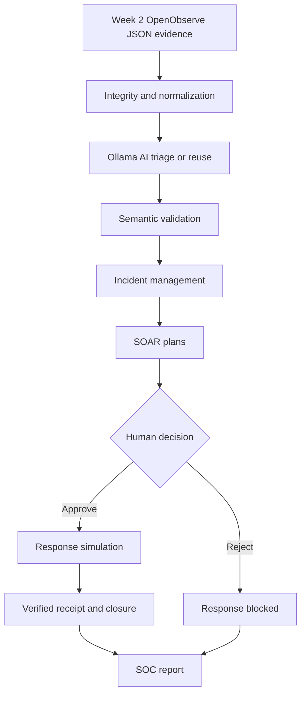

# DEPI Project 5 — Week 3 | SOAR Playbooks & Automation

## Week-3 Implementation Status (2026-11-18)

**Status:** Four SOAR playbooks implemented and dispatched against real Week-2 evidence.
Seven tickets and seven audit logs produced. Final Week-3 acceptance remains **pending
human sign-off**.

### Implemented workstreams

- **SOAR dispatcher:** file-based automation engine that reads saved Week-2 evidence JSON
  and drives playbook execution. No live SIEM, no model re-execution, no executed
  remediation.
- **Four playbooks:** PB-01 SSH brute force, PB-02 malware, PB-03 web/XSS, PB-04 Exchange
  mailbox export (exfiltration hypothesis).
- **Three-tier automation model:** Tier 0 (auto), Tier 1 (propose, human-gated), Tier 2
  (prohibited, hard-blocked in code).
- **Local JSON ticket backend** with a documented TheHive adapter stub (not implemented).
- **Per-event audit trail** in JSONL format.
- **Seven real Week-2 alerts dispatched** into seven tickets; one legacy SIEM04 file
  cleanly skipped.

### Four playbooks and their automation ceilings

| ID | Alert rule | Tier max | Rationale |
|---|---|---|---|
| PB-01 | SIEM_AUTH_002_SSH_BRUTE_FORCE | Tier 1 (propose rate-limit) | Successful login not established (Week-2 SSH report §5) |
| PB-02 | SIEM_MAL_003_SUSPICIOUS_MALWARE_BEHAVIOR | Tier 1 (propose isolate) | Malware report §6: containment only after impact evaluation |
| PB-03 | SIEM_WEB_001 + SIEM_WEB_004_XSS | Tier 1 (propose WAF review) | HTTP correlation gap (Week-2 acceptance gate 2); XSS receiver self-checks weaker |
| PB-04 | SIEM_EXCHANGE_005_SUSPICIOUS_MAILBOX_EXPORT | **Tier 0 only** | Exchange receiver hard-codes `qa_status: REVIEW_REQUIRED`; no Exchange screenshots; review unconfirmed |

"Phishing" in the project brief is represented by PB-04 (mailbox export targeting the
Administrator mailbox — the closest Week-2 evidence gets to a credential/phishing
narrative). "Data exfiltration" is PB-04's *hypothesis* framing, explicitly labelled
unverified.

### Five deliverables mapping

| Brief requirement | Week-3 artifact | Status |
|---|---|---|
| SOAR playbooks | `SOAR/playbooks/PB-01..04.{yaml, md}` | ✅ complete |
| Automation decision matrix | `SOAR/decision-matrix.md` | ✅ complete |
| Manual vs automated steps | `SOAR/manual-vs-automated.md` | ✅ complete |
| Integration diagram | `SOAR/diagrams/{logical,deployment}.md` (mermaid) | ✅ complete |
| Test results | `SOAR/test-results.md` + `Evidence/Screenshots/` | ✅ complete |

### Outstanding acceptance items

- Human analyst sign-off pending on all seven tickets (`review_status = Pending Review`).
- Week-2 acceptance still PENDING (six gates). Week 3 automates triage and enrichment,
  not the acceptance-pending conclusions.
- HTTP correlation gap (Week-2 gate 2) limits PB-03 propose tier to WAF review.
- Exchange receiver hard-codes `REVIEW_REQUIRED` → PB-04 is Tier 0 only.
- No live TheHive, no live TI, no live SIEM, no executed remediation, no AI re-execution.
- Exchange `event_id` is replay-time-dependent; Exchange tickets are not stable across
  replays.

### Related documentation

- [`Week-3-Final-Report.md`](Week-3-Final-Report.md) — final report
- [`SOAR/README.md`](SOAR/README.md) — technical package README
- [`Documentation/Week-3-Testing-Guide.md`](Documentation/Week-3-Testing-Guide.md) — how to run
- [`Documentation/Integration-Workflow.md`](Documentation/Integration-Workflow.md) — end-to-end narrative
- [`Documentation/Dispatcher-Runbook.md`](Documentation/Dispatcher-Runbook.md) — operational guide
- [`Documentation/Dispatcher-Change-Log.md`](Documentation/Dispatcher-Change-Log.md) — the four fixes applied after real-evidence testing
- [`Evidence/README.md`](Evidence/README.md) — evidence index and screenshots

### What this week does NOT claim

- That any Week-2 acceptance gate has been resolved.
- That any remediation was executed.
- That any live SIEM, live TheHive, or live threat-intelligence feed was used.
- That any analyst has approved any ticket.
- That any AI model was re-run in Week 3.

These limitations mirror Week-2's honesty discipline and are stated, not hidden.

<!-- SCENARIO-ORCHESTRATOR-V1.2.0 -->

---

## Scenario Orchestrator V1.2.0 extension

This independent extension preserves the original team SOAR implementation and consumes Week 2 OpenObserve AI-triage JSON evidence.

### Demonstrated results

| Metric | Observed result |
|---|---:|
| Week 2 evidence records | 8 |
| Incidents / response plans | 7 / 7 |
| Manual review records | 1 |
| Reused / newly processed AI results | 5 / 2 |
| Semantic PASS / PASS_WITH_WARNINGS | 3 / 4 |
| Verified simulations / closed incidents | 1 / 1 |
| External response actions | 0 |

Historical evidence replay is not live SIEM streaming. All response actions are simulated. Interactive confirmation is not authenticated analyst identity. SHA256 checks depend on trusted reference hashes; replay protection is workspace-scoped. AI findings and warnings require analyst interpretation. Exchange alerts do not establish exfiltration or phishing. Clean-machine portability is not yet verified; historical artifacts may contain absolute paths. Fresh runs may produce different AI results and cache counts.

[Technical README](Scenario-Orchestrator/README.md) | [Operational guide](Week-3-Operational-Guide.md) | [Final report](Week-3-Final-Report.md)

<!-- REPRODUCIBILITY-VALIDATION -->
## Reproducibility Validation

Scenario Orchestrator V1.2.0 was successfully executed from
a clean repository working copy on Windows without cached
AI results or previous runtime artifacts.

All seven eligible alerts were analyzed using local Ollama.
Seven incidents and seven SOAR plans were generated.
Final SOC report generation completed successfully.

No paid service or personal SIEM credentials were required
for the historical evidence workflow.
