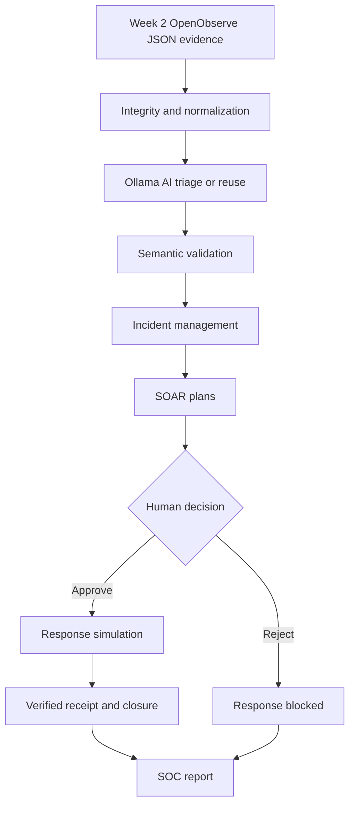

# Scenario Orchestrator V1.2.0

Additional Week 3 implementation; original team SOAR remains independent.

## Architecture



## Components

| File | Responsibility |
|---|---|
| main.py | Unified CLI |
| evidence_loader.py | Evidence discovery and integrity |
| normalizer.py | Normalized records |
| schema.py | Structured validation |
| ai_reprocessor.py | Local Ollama processing and result reuse |
| semantic_validator.py | Evidence-to-analysis checks |
| incident_manager.py | Lifecycle, approval and store protection |
| orchestrator.py | Integrated processing |
| playbook_engine.py | Response plans |
| response_simulator.py | Controlled simulation and receipts |
| report_generator.py | HTML, JSON and CSV reporting |

## Playbooks

PB-001 WEB_HIGH_RATE; PB-002 SSH_BRUTE_FORCE; PB-003 MALWARE; PB-004 XSS; PB-005 EXCHANGE.

## Security controls

Evidence and artifact hashes, manual review gates, plan-bound approval, audit checks, receipt enforcement, closure protection, execution reservation and workspace replay protection. No external remediation.

## Quick start

```powershell
python main.py --version
python main.py --help
ollama list
python main.py prepare --evidence "<EVIDENCE_DIRECTORY>"
```

See [Operational guide](../Week-3-Operational-Guide.md) for the full workflow.

## Demonstrated results

| Metric | Observed result |
|---|---:|
| Week 2 evidence records | 8 |
| Incidents / response plans | 7 / 7 |
| Manual review records | 1 |
| Reused / newly processed AI results | 5 / 2 |
| Semantic PASS / PASS_WITH_WARNINGS | 3 / 4 |
| Verified simulations / closed incidents | 1 / 1 |
| External response actions | 0 |

## Limitations

Historical evidence replay is not live SIEM streaming. All response actions are simulated. Interactive confirmation is not authenticated analyst identity. SHA256 checks depend on trusted reference hashes; replay protection is workspace-scoped. AI findings and warnings require analyst interpretation. Exchange alerts do not establish exfiltration or phishing. Clean-machine portability is not yet verified; historical artifacts may contain absolute paths. Fresh runs may produce different AI results and cache counts.
